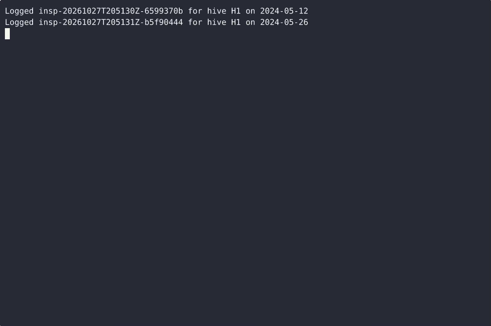
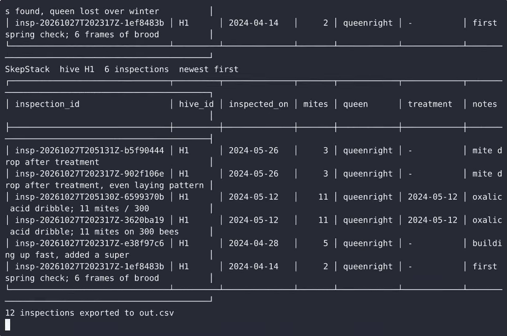

# SkepStack — complete Full-stack app command-line tool example app

If you want a self-hosted command-line tool without the vendor lock-in, **SkepStack** is ready to run. Built with Full-stack app and Apache-2.0-licensed, SkepStack ships complete — one clone, one install command. Build SkepStack, a single-file Python CLI for offline beekeeping inspection provenance. [Open SkepStack on cenius.ai](https://cenius.ai/marketplace/p/skepstack?ref=gh&utm_campaign=skepstack-webapp) to customise it without touching a line of SkepStack code.


[](LICENSE)  [](https://cenius.ai)

[](https://cenius.ai/marketplace/p/skepstack?ref=gh&utm_campaign=skepstack-webapp)

> **▶ [Open & edit in cenius.ai](https://cenius.ai/marketplace/p/skepstack?ref=gh&utm_campaign=skepstack-webapp)** — one click to an editable workspace: describe changes in plain English, get an instant preview, one-click deploy and host. Modifications made on the platform come with full rebrand & relicense rights.

_Local clone? See [Quick start](#quick-start) below. cenius.ai is the zero-setup path._

## Demo


▶ **[Video walkthrough](https://cenius.ai/marketplace/p/skepstack?ref=gh&utm_campaign=skepstack-webapp)** — see the app in action on the cenius.ai project page · [MP4 file](.github/media/demo.mp4)

## Screenshots

 

## Quick start

```bash
./install.sh   # installs dependencies + seeds demo data
```

See [`INSTALL.md`](INSTALL.md) for full setup and usage instructions.

## Usage guide

Five walkthroughs against a real ledger. Every command below is copy-pasteable;
`python3 skepstack.py` can be shortened to `skepstack` once `install.sh` has run.

### 1. Log the first inspection of the season

```bash
python3 skepstack.py log --hive H1 --date 2024-04-14 --mites 2 --queen queenright \
        --notes "first spring check; 6 frames of brood"
```

```
Logged insp-20240414T072233Z-5b0c9d47 for hive H1 on 2024-04-14
```

The ledger file `./skepstack-ledger.jsonl` is created on that first successful
save. Every later inspection is appended as one more JSON line; earlier lines are
never rewritten. Quote the `inspection_id` when you need to point at exactly one
observation — it is unique and sorted roughly by when it was recorded.

### 2. A rejected inspection writes nothing

```bash
python3 skepstack.py log --hive 'H 1!' --date 2024-13-01 --mites -2 --queen maybe
```

```
hive_id: use 1-32 letters, digits, hyphens or underscores
inspected_on: not a valid ISO date (YYYY-MM-DD)
mite_count: must be a whole number 0 or greater
queen_status: must be one of queenright, queenless, virgin, unknown
```

One line per bad field, exit code 2, and the ledger is untouched (not even
created if this was the first attempt). Nothing is ever half-written.

### 3. Read the ledger back

```bash
python3 skepstack.py list
python3 skepstack.py list --hive H1
```

_Full guide: [`USAGE.md`](USAGE.md)_

## Features

- Record inspection
- CSV import/export
- List and review inspections

## Architecture

Folder layout: `samples/`, `scripts/`, `tests/`. Kick off `./install.sh` to pull packages and seed the database, then the app is up. Built in Full-stack app (32 files). For environment-specific setup, see [`INSTALL.md`](INSTALL.md).

## FAQ

### How do I self-host SkepStack?

Clone this repository and run `./install.sh`, then start the app as described in [`INSTALL.md`](INSTALL.md). SkepStack is fully self-hostable — no external services are required to try it.

### How do I customise SkepStack's branding?

Yes. You can edit the source directly under the MIT license, or [remix it on cenius.ai](https://cenius.ai/marketplace/p/skepstack?ref=gh&utm_campaign=skepstack-webapp) — the platform route grants full rebrand and relicense rights over your derivative.

### Is there a no-code way to modify SkepStack?

[cenius.ai](https://cenius.ai/marketplace/p/skepstack?ref=gh&utm_campaign=skepstack-webapp) handles the implementation. Tell it what you want in everyday words, pick up the updated build. No coding needed.

### Which technology stack does SkepStack use?

Full-stack app end-to-end. Every file you need to run the app is here in this repository — code, configuration, seed data. Highlights include list and review inspections.

### Is SkepStack free for commercial use?

Yes — Apache-2.0-licensed, so commercial use, modification, and distribution are all permitted. Read the full terms in [LICENSE](LICENSE).

## License & rebranding

Released under the [Apache License 2.0](LICENSE) (© 2026 Cenius AI) — free for personal and commercial use. The Cenius name/logo are trademarks (see NOTICE).

**Need a customized version?** [Remix this app on cenius.ai](https://cenius.ai/marketplace/p/skepstack?ref=gh&utm_campaign=skepstack-webapp) — modifications made on the platform come with **full rebrand & relicense rights** over your derivative.

## Built with cenius.ai

This entire application — code, design, seeded demo data — was generated on **[cenius.ai](https://cenius.ai)** from a plain-English description.

- 🚀 [Build your own app on cenius.ai](https://cenius.ai)
- 🎛️ [Remix SkepStack on the marketplace](https://cenius.ai/marketplace/p/skepstack?ref=gh&utm_campaign=skepstack-webapp) — open it in a workspace, prompt for changes, and ship your own version.

More open-source apps: [the Cenius-ai catalog](https://github.com/Cenius-ai) · [showcase index](https://github.com/Cenius-ai/showcase)
